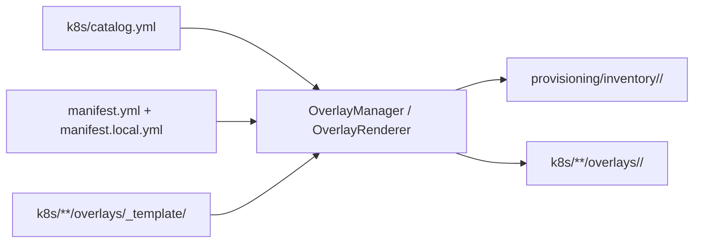

# `app/scaffold` — overlays a partir do catálogo

Engine usada pelo comando `k8s-blueprint` ([`app/cli.py`](../cli.py)) e pelo menu
interativo ([`app/tui/`](../tui/)) para criar, renderizar, validar e remover
overlays.

## Visão geral



| Módulo | Responsabilidade |
|--------|------------------|
| [`catalog.py`](catalog.py) | Lê `k8s/catalog.yml`; resolve stacks e componentes de um overlay e valida dependências (`Catalog.select`) |
| [`render.py`](render.py) | Renderiza cada `overlays/_template/` da seleção em `overlays/<id>/` (Jinja2); `drift()` compara com o que está em disco |
| [`overlays.py`](overlays.py) | `OverlayManager`: valida o pedido, sugere IP, grava `manifest.local.yml`, gera inventário e `90_local.yml`, renderiza e remove |
| [`dns.py`](dns.py) | Registros A esperados por overlay e checagem de resolução |
| [`validate.py`](validate.py) | `kustomize build` em todos os overlays |

## Comandos

```bash
uv run k8s-blueprint                    # menu interativo (igual a `tui`)
uv run k8s-blueprint catalog            # stacks e componentes
uv run k8s-blueprint overlay list
uv run k8s-blueprint overlay show broetec-storage
uv run k8s-blueprint overlay new meu-lab --from broetec-storage \
    --disable storage/harbor --vcpus 4 --memory-mb 12288
uv run k8s-blueprint overlay render broetec-core [--check]
uv run k8s-blueprint overlay rm meu-lab [--purge-env] [--force]
uv run k8s-blueprint secrets init -o meu-lab
uv run k8s-blueprint secrets show -o meu-lab [nome]
uv run k8s-blueprint dns check [-o overlay]
uv run k8s-blueprint validate [-o overlay] [--strict]
```

Atalhos Make: `make tui`, `make new`, `make overlays`, `make rm-overlay`,
`make catalog`, `make dns-check`, `make validate-k8s`
([`make/overlays.mk`](../../make/overlays.mk)).

## Regras de um overlay local

| Regra | Motivo |
|-------|--------|
| Nome `[a-z0-9-]`, até 40 caracteres | Vira nome de diretório e, por padrão, da VM |
| Prefixos `broetec-` e `_` reservados | `broetec-*` e `_template` são versionados (`.gitignore`) |
| IP dentro da rede do lab, fora da faixa DHCP e sem uso | IP estático via cloud-init |
| Stack `core` sempre incluída; componentes obrigatórios não saem | Bootstrap do role 04 depende deles |
| Domínio padrão `<ip-com-hífens>.sslip.io`, TLS `selfsigned` | Funciona sem criar DNS nem token |

`overlay rm` só remove overlays locais e se recusa a rodar com o disco da VM
presente (`make destroy OVERLAY=<id>` antes, ou `--force`).

## Templates

Cada diretório listado em `dirs` no catálogo tem `overlays/_template/`,
renderizado com Jinja2 usando delimitadores próprios para não colidir com
Helm (`{{ }}`) nem com `$repoData`:

| Sintaxe | Uso |
|---------|-----|
| `[[ var ]]` | Variável |
| `[% if 'storage/harbor' in components %] … [% endif %]` | Bloco condicional |
| `[# … #]` | Comentário do template |

Variáveis: `overlay_id`, `node_name`, `vm_ip`, `apps_domain`, `iface`,
`tls_issuer`, `repo_url`, `revision`, `stacks` (lista) e `components` (lista de
`<stack>/<componente>`). Um arquivo que renderiza vazio não é escrito — é assim
que um template some quando o componente opcional não foi escolhido.

Os overlays versionados (`broetec-*`) são saída do mesmo render:
`tests/test_k8s_versioned_overlays.py` falha se alguém os editar à mão. Para
mudar um deles, altere o template (ou o `k8s:` no `manifest.yml`) e rode
`uv run k8s-blueprint overlay render <id>`.

## Acrescentar um componente

1. Crie `k8s/<stack>/<componente>/base/` e `overlays/_template/`.
2. Crie a `Application` em `k8s/<stack>/applications/base/` e os patches e
   `replacements` dela em `applications/overlays/_template/`.
3. Declare o componente em `k8s/catalog.yml` (`dirs`, `requires`, `hosts`).
4. `uv run k8s-blueprint overlay render <id>` nos overlays versionados que o
   usam e `make validate-k8s`.

## Testes

```bash
uv run pytest tests/test_scaffold_catalog.py tests/test_scaffold_overlays.py \
    tests/test_k8s_versioned_overlays.py tests/test_tui_wizard.py
```
