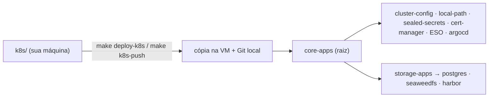

# `k8s/` — manifests Kubernetes

Manifests do cluster organizados por **stack**, no padrão *app-of-apps* do
Argo CD: cada stack tem `applications/` (as `Application`) e um diretório por
componente com `base/` e `overlays/<id>/`.

O role [`04_deploy_k8s`](../provisioning/roles/04_deploy_k8s/README.md) faz o
bootstrap mínimo (Cilium, local-path, chave do Sealed Secrets, Argo CD) e aplica
a `Application` raiz do overlay. A partir daí o Argo CD instala e mantém todo o
resto.

## Layout

```
k8s/
├── catalog.yml                 # stacks, componentes, dependências, hosts
├── core/                       # obrigatória em todo overlay
│   ├── applications/{base,overlays/<id>}
│   ├── cluster-config/         # Cilium (Gateway, LB-IPAM, L2) + PriorityClasses
│   ├── local-path-provisioner/
│   ├── sealed-secrets/
│   ├── cert-manager/
│   ├── external-secrets-operator/   (opcional)
│   └── argocd/
└── storage/
    ├── applications/{base,root,overlays/<id>}
    ├── secret-stores/          # namespaces + ClusterSecretStores (External Secrets)
    ├── postgres/{operator,clusters/{seaweedfs,harbor}}
    ├── seaweedfs/{operator,clusters/lab}
    └── harbor/                 (opcional)
```

| Diretório | Conteúdo | Versionado |
|-----------|----------|------------|
| `<componente>/base/` | Values Helm e recursos comuns a todos os overlays | Sim |
| `<componente>/overlays/_template/` | Molde do overlay (Jinja2 com `[[ var ]]`) | Sim |
| `<componente>/overlays/broetec-*/` | Overlays do lab de referência, **gerados** a partir do molde | Sim |
| `<componente>/overlays/<outro>/` | Overlays locais (`k8s-blueprint overlay new`) | Não |
| `**/*-sealedsecret.yaml` | Selados com a chave BYOK de cada máquina | Não |

`overlays/<id>` usa o mesmo `<id>` em todos os componentes: é o nome do overlay
do inventário (`OVERLAY=`).

## Overlays versionados

| Overlay | Stacks | Domínio das apps |
|---------|--------|------------------|
| `broetec-core` | core | `core.local.broetec.com.br` |
| `broetec-storage` | core + storage | `storage.local.broetec.com.br` |
| `broetec-monitor` | core | `monitor.local.broetec.com.br` |

A seleção fica em `k8s:` no
[`manifest.yml`](../provisioning/inventory/manifest.yml). Não edite os arquivos
de `overlays/broetec-*` à mão: altere o `_template` (ou o manifest) e rode
`uv run k8s-blueprint overlay render <id>`; um teste acusa divergência.

## Como o Argo CD lê os manifests



- Cada `Application` de `applications/base` aponta para o repositório do
  catálogo (`https://github.com/broetec/k8s-blueprint.git`, `main`). O overlay
  ajusta os caminhos (`overlays/<id>`) e propaga `repoURL`/`targetRevision` a
  partir de `_release-source.yaml` com `replacements`.
- **No lab (padrão, `argo_source: local`)** o role 04 reescreve
  `_release-source.yaml` só na cópia da VM e publica essa cópia num repositório
  Git servido pela própria VM (`git@<ip>:k8s-blueprint.git`). Assim overlays não
  commitados, e mudanças ainda não enviadas ao GitHub, funcionam.
- **Em produção** (`argo_source: remote`) vale o que está commitado: aponte
  `repo.url` do catálogo (ou o `_release-source.yaml` do overlay) para o seu
  repositório e, se ele for privado, crie o Secret de repositório do Argo CD.

Ciclo do dia a dia: edite arquivos em `k8s/` e rode `make k8s-push`. O role
reenvia a árvore, faz o commit no Git local e pede *refresh* ao Argo CD.

## Montar um overlay próprio

```bash
make tui                                    # menu interativo
make new NAME=meu-lab FROM=broetec-storage  # sem interação
make up OVERLAY=meu-lab
```

O gerador lê o [`catalog.yml`](catalog.yml), renderiza os `_template` dos
componentes escolhidos e cria o inventário. Depois disso os arquivos de
`overlays/meu-lab/` são seus: edite, acrescente recursos e teste com
`make k8s-push OVERLAY=meu-lab` antes de levar para produção. Detalhes da
engine em [`app/scaffold/README.md`](../app/scaffold/README.md).

## Domínio, DNS e TLS

As aplicações ficam em `<app>.<domínio do overlay>` atrás do Gateway `public`
(Cilium), que usa o IP da VM.

| Caso | Domínio | DNS | Emissor TLS |
|------|---------|-----|-------------|
| Overlays `broetec-*` | `<papel>.local.broetec.com.br` | registro A curinga por VM | `letsencrypt-prod` (com token) ou `selfsigned` |
| Overlay local (padrão) | `<ip-com-hífens>.sslip.io` | nenhum | `selfsigned` |
| Overlay local com domínio próprio | o que você informar | registro A curinga `*.<domínio>` → IP da VM | à escolha |

`make dns-check` mostra os registros esperados e os que não resolvem. Um
emissor `letsencrypt-*` precisa do token Cloudflare em
`core/cert-manager/overlays/<id>/api-token-secret.yaml` (copie do `.example`);
sem o arquivo o role 04 usa `selfsigned` naquele deploy.

## Segredos

- A chave do Sealed Secrets é gerada localmente (BYOK) em `env/<overlay>/`.
- Arquivos `*-secret.yaml.example` com marcadores `<lab:NOME>` viram
  `*-secret.yaml` com valores aleatórios (`uv run k8s-blueprint secrets init`),
  guardados em `env/<overlay>/lab-secrets.yml`. O mesmo nome gera o mesmo valor
  em arquivos diferentes.
- O role 04 sela tudo em `*-sealedsecret.yaml` antes de enviar para a VM.
- Ver valores: `uv run k8s-blueprint secrets show -o <overlay>`.

Login do Argo CD no lab: `admin` / `broetec` (Secret didático versionado em
`core/argocd/overlays/*/admin-secret.yaml`).

## Diferenças do lab em relação a produção

| Item | Lab | Produção (referência) |
|------|-----|-----------------------|
| Fonte do Argo CD | Git local da VM | Repositório remoto |
| Backup do PostgreSQL (pgBackRest) | Repositório em PVC | Repositório S3 |
| Volume do SeaweedFS | StorageClass `local-path` | PV dedicado |
| Harbor → S3 | Service interno, sem redirect | Endpoint público com TLS |
| Réplicas | 1 por componente | conforme o ambiente |

## Validação

```bash
make validate-k8s                 # kustomize build em todos os overlays
uv run pytest tests/              # inclui divergência template × overlays versionados
```

## Integração Make

- `make up` — VM + SO + RKE2 + role 04
- `make deploy-k8s` — só o role 04
- `make k8s-push` — reenviar `k8s/` e atualizar o Argo CD

Ver também: [Estrutura do projeto](../docs/structure.md).
