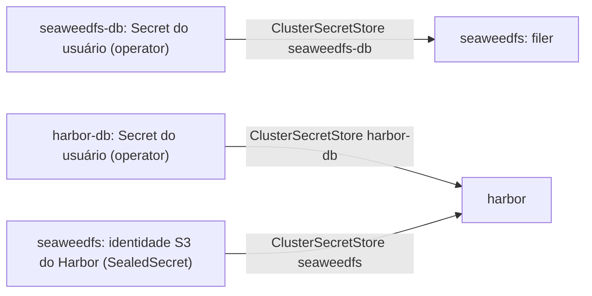

# Stack `storage`

PostgreSQL (Percona Operator), SeaweedFS (S3 + filer) e Harbor (registry),
gerenciados pelo Argo CD. Entra num overlay quando `storage` está em
`k8s.stacks` no manifest do inventário; requer o componente
`core/external-secrets-operator`.

## Componentes

| Componente | Diretórios | Obrigatório |
|------------|------------|-------------|
| `storage/postgres-operator` | `postgres/operator` | Sim |
| `storage/seaweedfs` | `secret-stores`, `seaweedfs/operator`, `seaweedfs/clusters/lab`, `postgres/clusters/seaweedfs` | Sim |
| `storage/harbor` | `harbor`, `postgres/clusters/harbor` | Não |

## Applications e ordem

| Onda | Application | Namespace | O que instala |
|------|-------------|-----------|---------------|
| -1 | `storage-secret-stores` | vários | Namespaces da stack, RBAC e `ClusterSecretStore` por namespace |
| 0 | `postgres-operator` | `pgo` | Percona Operator for PostgreSQL |
| 0 | `seaweedfs-operator` | `seaweedfs-operator` | Operator do SeaweedFS (Helm) |
| 1 | `seaweedfs-db` | `seaweedfs-db` | Cluster PostgreSQL dos metadados do filer |
| 1 | `harbor-db` | `harbor-db` | Cluster PostgreSQL do Harbor |
| 2 | `seaweedfs-cluster` | `seaweedfs` | Master, volume e filer (S3), proxy do filer, HTTPRoutes |
| 3 | `harbor` | `harbor` | Harbor (Helm) + jobs de bootstrap e de robôs |

O `AppProject storage` e a Application `storage-apps` ficam em
`applications/root/` e são incluídos pelo overlay do core.

## Como as credenciais circulam



- Senhas de banco são geradas pelo operator e lidas por `ExternalSecret`.
- As identidades S3 são Secrets com o label `seaweedfs-s3-identity=true`; o
  CronJob `seaweedfs-s3-sync` monta o `s3.conf` do filer com elas e cria os
  buckets (roda a cada 2 minutos).
- Os Secrets de entrada (`*-secret.yaml.example` com `<lab:NOME>`) são gerados
  e selados pelo role 04: admin S3, identidade do registry, basic auth do filer
  e usuários do Harbor.

```bash
uv run k8s-blueprint secrets show -o <overlay> harbor-admin-password
uv run k8s-blueprint secrets show -o <overlay> filer-password   # usuário admin
```

## URLs

| Host | Serviço |
|------|---------|
| `harbor.<domínio>` | Harbor (usuário `admin`) |
| `s3.<domínio>` | API S3 do SeaweedFS |
| `filer.<domínio>` | Filer do SeaweedFS atrás de basic auth |

## Escolhas do lab

| Item | Lab | Em produção |
|------|-----|-------------|
| Backup do PostgreSQL | pgBackRest com repositório em PVC | Repositório S3 (`repos[].s3` + Secret de credenciais) |
| Volume do SeaweedFS | StorageClass `local-path`, 20Gi | PV dedicado em disco próprio |
| Harbor → S3 | Service interno (`http`), `disableredirect: true` | Endpoint público com TLS |
| Projetos do Harbor | `library` e `apps` (`harbor/base/harbor-bootstrap-configmap.yaml`) | Os do seu ambiente |

## Tamanho de VM

Mínimo sugerido no catálogo: 6 vCPUs, 16 GB de RAM e 120 GB de disco
(`stacks.storage.vm` em [`../catalog.yml`](../catalog.yml)).
