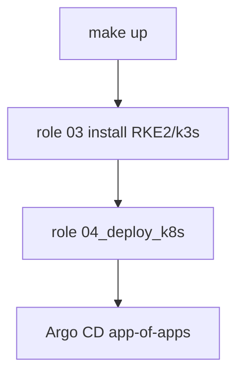

# `04_deploy_k8s` — Kubernetes bootstrap + hand-over to Argo CD

Ansible role **04** in the k8s-blueprint lab pipeline. Takes a cluster that is
Ready (role **03**) to "everything managed by Argo CD": it applies the minimal
bootstrap (Cilium config, local-path, Sealed Secrets key, Argo CD), publishes
`k8s/` to a Git repository served by the node and applies the root Application
of the overlay. From there Argo CD installs the rest (sealed-secrets,
cert-manager, External Secrets and the other stacks).

**Prerequisite:** cluster already installed and reachable (`kubectl` working on
the VM).

Part of `make up`. Can also run alone with `make deploy-k8s`.

## Position in the pipeline



| Make target | What it runs |
|-------------|--------------|
| `make deploy-k8s` | Role **04** only |
| `make k8s-push` | Re-send `k8s/` to the local Git of the VM and refresh Argo CD (tag `k8s_push`) |
| `make reset-k8s` | Teardown: deletes all namespaces/Helm releases except the protected baseline, without uninstalling the cluster (role [`reset_k8s`](../reset_k8s/README.md)) |
| `make redeploy-k8s` | `reset-k8s` + `deploy-k8s` (re-apply step 04 from scratch) |
| `make deploy` | Roles **03–04** (refresh k8s without recreating the VM) |
| `make up` | Roles **01–04** (full pipeline) |

## Quick start

```bash
make deploy-k8s OVERLAY=broetec-core
# day-to-day loop: edit k8s/, then
make k8s-push OVERLAY=broetec-core
# read the committed repoURL (GitHub) instead of the local Git:
make deploy-k8s OVERLAY=broetec-core ARGO_SOURCE=remote
```

## Pipeline (`tasks/`)

| Step | Tasks | What it does | Tags |
|------|-------|--------------|------|
| **Seal (offline)** | [`seal.yml`](tasks/seal.yml) | Generate/reuse the BYOK keypair in `env/<overlay>/`, create the missing lab Secrets (`k8s-blueprint secrets init`) and seal every `*-secret.yaml` of the overlay into `*-sealedsecret.yaml` on the controller (no `kubeseal`) | `deploy_k8s`, `sealed_secrets`, `k8s_push` |
| **Sync** | [`sync.yml`](tasks/sync.yml) | Pack `k8s/` (without plain Secrets) and unpack it on the VM as an exact mirror (`~/<deploy_k8s_remote_dir>/k8s`); check `helm`/`kubectl`/`git` | `deploy_k8s`, `k8s_push` |
| **Lab overrides** | [`overrides.yml`](tasks/overrides.yml) | Rewrite, in the VM copy only, `_release-source.yaml` (Argo CD source) and `_tls-issuer.yaml` (Gateway issuer) | `deploy_k8s`, `k8s_push` |
| **Cluster config** | [`cluster_config.yml`](tasks/cluster_config.yml) | Gateway API CRDs (server-side) → wait Established → restart `cilium-operator` when the CRD bundle version or channel changed (first install, upgrade or channel switch) → `kubectl apply --server-side -k k8s/core/cluster-config/overlays/<overlay>` | `deploy_k8s`, `cluster_config` |
| **local-path** (rke2 only) | [`local_path.yml`](tasks/local_path.yml) | Namespace (PSA) + Helm OCI chart, so Argo CD's PVCs have a StorageClass | `deploy_k8s`, `local_path` |
| **Bootstrap secrets** | [`sealed_secrets.yml`](tasks/sealed_secrets.yml) | Pre-apply the BYOK controller key and, when present, the Cloudflare token (both piped from the controller; nothing is left on the VM) | `deploy_k8s`, `sealed_secrets` |
| **Argo CD** | [`argocd.yml`](tasks/argocd.yml) | Helm install with the same chart version, release name and values as the `argocd` Application | `deploy_k8s`, `argocd` |
| **Local Git** | [`git_local.yml`](tasks/git_local.yml) | `git` system user (git-shell), bare repo, key pair, commit + push of `k8s/`, Argo CD repository Secret | `deploy_k8s`, `argocd`, `k8s_push` |
| **Root app** | [`root_app.yml`](tasks/root_app.yml) | `kubectl apply -k k8s/core/applications/overlays/<overlay>`, hard refresh, wait for every Application to be Synced/Healthy | `deploy_k8s`, `argocd`, `k8s_push` |

Sealing and packaging run on the controller (`delegate_to: localhost`). `helm`,
`kubectl` and `git` run on the VM as the connecting user (`become: false`).

### What Argo CD takes over

The root Application `core-apps` creates one Application per component of the
overlay ([`k8s/core/applications`](../../../k8s/core/applications/)). Argo CD
then:

- installs `sealed-secrets` (adopting the pre-applied key), `cert-manager`,
  `external-secrets-operator` and, when selected, the other stacks
  (`storage-apps` → [`k8s/storage/applications`](../../../k8s/storage/applications/));
- adopts what the role installed by hand: `cluster-config`,
  `local-path-provisioner` and `argocd` itself.

The chart versions pinned here (`argocd_chart_version`,
`deploy_k8s_local_path_chart_version`) must match the `targetRevision` of the
Applications; `tests/test_k8s_versioned_overlays.py` enforces it.

## Source read by Argo CD

| `argo_source` | Behaviour |
|---|---|
| `local` (default) | `k8s/` is committed on the VM and pushed to `~git/k8s-blueprint.git`; Argo CD clones `git@<vm_ip>:k8s-blueprint.git` over SSH (repository Secret `k8s-blueprint-local-git`, host key not pinned — lab only). Nothing has to be pushed to GitHub, so uncommitted and gitignored overlays work. |
| `remote` | `_release-source.yaml` is used as committed (`repoURL`/`targetRevision` from `k8s/catalog.yml`). Changes only reach the cluster after a push. A private repository needs its own repository Secret. |

Set it per overlay in the inventory manifest (`k8s.argo_source`) or per run with
`ARGO_SOURCE=`.

## Gateway TLS issuer

The overlay declares the ClusterIssuer of the Gateway (`k8s.tls_issuer` in the
inventory manifest, override with `TLS_ISSUER=`). A `letsencrypt-*` issuer
needs the Cloudflare token in
`k8s/core/cert-manager/overlays/<overlay>/api-token-secret.yaml` (gitignored,
copy from the `.example`). Without the file the role reports the fallback and
uses `selfsigned` for that run, so HTTPS keeps working.

## Key variables (`defaults/main.yml`)

| Variable | Default | Description |
|---|---|---|
| `deploy_k8s_enabled` | `true` | Master switch for the whole role |
| `deploy_k8s_overlay` | `{{ overlay_id }}` | k8s overlay name (e.g. `broetec-core`) |
| `deploy_k8s_remote_dir` | `manifests/k8s-blueprint` | Directory on the VM; holds `k8s/` and the Git working tree |
| `deploy_k8s_repo_root` | `{{ playbook_dir \| dirname }}` | Repo root on the controller |
| `deploy_k8s_argo_source` | `{{ argo_source \| default('local') }}` | `local` or `remote` |
| `deploy_k8s_tls_issuer` | `{{ tls_issuer \| default('selfsigned') }}` | Wanted Gateway issuer |
| `deploy_k8s_git_user` / `_git_repo_name` | `git` / `k8s-blueprint.git` | Local Git user and bare repository |
| `deploy_k8s_git_host` | `{{ vm_ip }}` | Address Argo CD uses to reach the node's sshd |
| `deploy_k8s_argocd_wait_timeout` | `1800` | Seconds to wait for Synced/Healthy |
| `sealed_secrets_keydir` | `env/{{ deploy_k8s_overlay }}` | BYOK keypair location (relative to repo root) |
| `argocd_chart_version` | `9.4.10` | Argo CD Helm chart version |
| `deploy_k8s_local_path_chart_version` | `0.0.35` | local-path-provisioner chart version |

See [`defaults/main.yml`](defaults/main.yml) for the complete list.

## Sealed Secrets (BYOK)

Sealed Secrets is always used: Argo CD reads Git, so every Secret has to reach
the cluster as a SealedSecret.

1. The role generates the key **locally** with `k8s-blueprint-seal genkey` in
   `env/<overlay>/` (reused on later runs).
2. Lab Secrets are created from `*-secret.yaml.example` files that hold
   `<lab:NAME>` placeholders; values live in `env/<overlay>/lab-secrets.yml`
   (`uv run k8s-blueprint secrets show -o <overlay>`).
3. Plain Secrets are sealed offline (`k8s-blueprint-seal seal`, no `kubeseal`).
4. The controller key is pre-applied (label `active`) **before** Argo CD
   installs the controller, which adopts it on startup.

When reinstalling the controller (cluster migration / DR), restore the **original
master key** before applying `SealedSecret`; otherwise a new key is generated and
old secrets cannot be decrypted. See
[`k8s/core/sealed-secrets/README.md`](../../../k8s/core/sealed-secrets/README.md).

## Tags

| Tag | What it runs |
|---|---|
| `deploy_k8s` | All task imports in this role |
| `k8s_push` | Seal + sync + overrides + local Git + root app/refresh/wait |
| `cluster_config` | Cilium + PriorityClasses only |
| `local_path` | local-path-provisioner (rke2 only) |
| `sealed_secrets` | Offline sealing + bootstrap secrets |
| `argocd` | Argo CD Helm + local Git + root Application |

## Notes

- **k3s:** the Argo CD flow targets RKE2 with Cilium. k3s ships its own
  local-path provisioner and no Cilium Gateway, so the `local-path-provisioner`
  and `cluster-config` Applications are not expected to work there.
- **Local Git user:** `git` can only run git commands (git-shell) and only
  accepts the key generated on the VM (`~/.ssh/k8s-blueprint-git`).

## Troubleshooting

```bash
make ssh
kubectl -n argocd get applications            # sync / health of every app
kubectl -n argocd describe application <app>  # conditions and last operation
git -C ~/manifests/k8s-blueprint log --oneline | head   # what was published
```

If Cilium does not apply Gateway changes automatically, restart the operator:

```bash
kubectl rollout restart deployment -n kube-system cilium-operator
```

## Reference

- [k8s/ manifests](../../../k8s/README.md)
- [Sealed Secrets](https://github.com/bitnami/sealed-secrets)
- [cert-manager](https://cert-manager.io/docs/)
- [Argo CD](https://argo-cd.readthedocs.io/)
