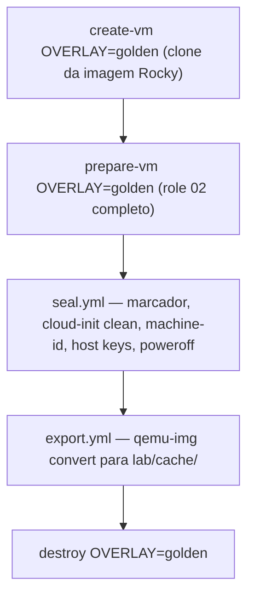

# `golden_image` — imagem base com o SO já preparado

Role utilitário (opt-in) que transforma uma VM temporária, já preparada pelo
role [`02_prepare_vm`](../02_prepare_vm/README.md), na **golden image** do lab:
`lab/cache/golden-rocky10.qcow2`. As VMs novas passam a nascer como clone ligado
dessa imagem e saltam o `dnf update` + reboot do role 02.

A golden **não** contém RKE2/k3s: o role 03 salta a instalação quando o binário
já existe, e isso impediria testar outra versão.

**Invocação:** `make golden` (refazer quando quiser pacotes atualizados).

## Fluxo do `make golden`

O overlay `golden` (VM `golden-builder`) existe só para reaproveitar
`make create-vm` e `make prepare-vm`; não faz parte do `make up-all`.

## O que o seal faz na VM

| Passo | Porquê |
|-------|--------|
| Grava `golden_image.marker` (`/etc/k8s-blueprint-golden`) | O role 02 salta `dnf update` e reboot nos clones |
| `cloud-init clean --logs --machine-id` | O clone corre o cloud-init como instância nova e gera `machine-id` próprio |
| Remove `cloud-init-*.nmconnection` e `/etc/ssh/ssh_host_*` | IP/MAC e host keys do builder não passam para os clones |
| `fstrim` + `poweroff` | Disco menor na exportação; o host só exporta com a VM desligada |

## Regra dos clones

`export.yml` recusa substituir a golden enquanto algum disco em `lab/disks/` a
usar como *backing file*: trocar o backing corrompe os clones. Destrua as VMs
(`make destroy`) antes de refazer a golden.

## Variáveis

| Variável | Default | Descrição |
|---|---|---|
| `golden_image.filename` | `golden-rocky10.qcow2` | Nome em `lab/cache/` (inventário `_shared`) |
| `golden_image.marker` | `/etc/k8s-blueprint-golden` | Marcador dentro da VM (inventário `_shared`) |
| `use_golden` | `true` | `USE_GOLDEN=false` no Make força a imagem Rocky crua |
| `golden_image_overlay` | `golden` | Único overlay que pode ser selado |
| `golden_image_shutdown_retries` / `_delay` | `60` / `3` | Espera pelo `shut off` do builder |
